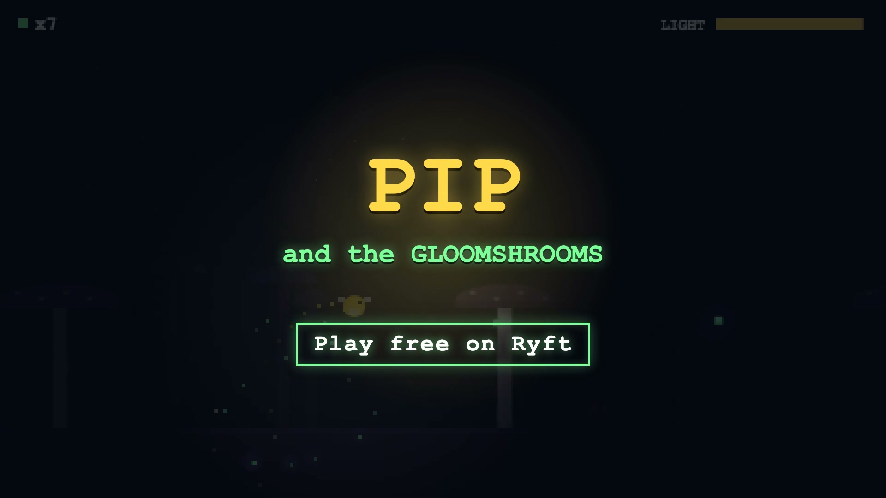

# Ryft Skills

**An open-source toolkit for [Ryft](#about-ryft) creators: turn what you imagine into a game, make it play great inside X posts, cut real-gameplay trailers, and launch it.**

Ryft builds 2D browser games from text prompts, and a Ryft game link posted on X becomes **a playable game inside the post**. These skills give your AI assistant (Claude Code, Claude.ai, or any agent that supports `SKILL.md` skills) the know-how of a game designer, a trailer editor and a launch marketer, plus tested tools that do the heavy lifting.

```
 imagine   →   build    →  feed-ready  →  trailer   →  launch on X  →   track
idea-spark   prompt-builder   feed-check    ryft-trailer   ryft-x-launch   campaign.mjs
art-director iterate          (480×480      record, cut,   posts that      what worked:
             level-designer    X card)      score, compare  play in-feed   formats, trailers
             password-save
             publish-ready
```

## Install

**Claude Code** (one command, every skill):

```text
/plugin install ryft-skills --marketplace jronnomo/ryft-skills
```

Or `/plugin marketplace add jronnomo/ryft-skills` then `/plugin install ryft-skills@ryft-skills`. Then just talk: *"I want to make a Ryft game about a raccoon in a supermarket"*, or run `/ryft-game-director`.

**The tools** (trailers, feed checks, campaign tracking) need Node 22+ and ffmpeg. The browser-based ones also need Playwright:

```bash
git clone https://github.com/jronnomo/ryft-skills.git && cd ryft-skills
npm install && npx playwright install chromium
```

**Claude.ai:** zip any skill folder (e.g. `.claude/skills/ryft-idea-spark/`) and upload it under Settings → Capabilities → Skills.
**Other assistants:** each `SKILL.md` is plain Markdown; paste it into custom instructions or project knowledge.

## The skills

| Stage | Skill | You get |
|---|---|---|
| Start | [`ryft-game-director`](.claude/skills/ryft-game-director/SKILL.md) | A guide that routes you to the right step |
| Imagine | [`ryft-idea-spark`](.claude/skills/ryft-idea-spark/SKILL.md) | A one-page **Game Concept Card**, even from "just a vibe" |
| Look | [`ryft-art-director`](.claude/skills/ryft-art-director/SKILL.md) | An uploadable **art bible**: style rules + named, reusable assets |
| Build | [`ryft-prompt-builder`](.claude/skills/ryft-prompt-builder/SKILL.md) | An uploadable **design brief** + a short first prompt, designed to play in an X post |
| Fix | [`ryft-iterate`](.claude/skills/ryft-iterate/SKILL.md) | One precise **reprompt** at a time, with annotated screenshots |
| Grow | [`ryft-level-designer`](.claude/skills/ryft-level-designer/SKILL.md) | Uploadable **level maps** and a difficulty curve |
| Save | [`ryft-password-save`](.claude/skills/ryft-password-save/SKILL.md) | NES-style **continue codes**: no save data needed |
| Ship | [`ryft-publish-ready`](.claude/skills/ryft-publish-ready/SKILL.md) | Stranger test, **feed check**, title, description, tags |
| Show | [`ryft-trailer`](.claude/skills/ryft-trailer/SKILL.md) | **Real-gameplay trailers** made to professional craft, compared and exported for X |
| Launch | [`ryft-x-launch`](.claude/skills/ryft-x-launch/SKILL.md) | A launch week of **drafted posts**, one-click compose links, and a **campaign tracker** |

Walk-through: [`examples/pip-and-the-gloomshrooms`](examples/pip-and-the-gloomshrooms/GAME.md). Start your own from [`templates/GAME.md`](templates/GAME.md).

## Games that play inside X posts

A Ryft link on X renders as a **480×480 playable card**. That's a phone-sized square, muted, often seen for a second while scrolling. A game designed for a 16:9 desktop window looks very different there. [`feed-check.mjs`](.claude/skills/ryft-x-launch/scripts/feed-check.mjs) measures it:

```bash
node .claude/skills/ryft-x-launch/scripts/feed-check.mjs https://ryft.fun/games/<id>-<slug> feed/
```

On a live 16:9 game it found the game filled **54%** of the card, drew everything at **24%** of its 1080p size (body text ≈ 5 px), and appeared after ~4.5 s. It also says what to ask Ryft for (square layout, bigger type, one-tap start). The prompt builder and publish checklist now design for the card from the first prompt.

## Launching on X

[`ryft-x-launch`](.claude/skills/ryft-x-launch/SKILL.md) is built on [research with sources](.claude/skills/ryft-x-launch/references/x-playbook.md):
- **Ryft games play right in the post:** confirmed by creators playing Ryft games inside X posts.
- **How X ranks posts:** from the open-sourced ranker, copy-link shares weigh 20×, replies and DM shares 5×, likes 0.66×.
- **Formats that work:** native clips with the game in the first reply, playable posts, challenges, loops, devlogs.
- **What automation X forbids.**

**It drafts; you post.** X permanently suspends browser-scripted automation, so there are no bots here. [`campaign.mjs`](.claude/skills/ryft-x-launch/scripts/campaign.mjs) keeps a local `campaign.json`:

```bash
node campaign.mjs init https://ryft.fun/games/<id>-<slug>   # checks the playable card
node campaign.mjs add --type playable --text "..."           # one-click compose link
node campaign.mjs log p1 impressions=4200 replies=19 linkClicks=140
node campaign.mjs report                                     # compare formats and trailer versions
```

## Trailers that look like game trailers

[`ryft-trailer`](.claude/skills/ryft-trailer/SKILL.md) follows what working trailer editors teach ([reference with sources](.claude/skills/ryft-trailer/references/trailer-craft.md)): gameplay in the first 2 seconds, genre → hook → content, the game's own sounds, readable shots on a phone, title last, then a 20-point grade before delivery.

| Tool | What it does |
|---|---|
| `record.mjs` | Plays a game from a script of inputs and records it, **with the game's own audio** (synced within a frame) and **2× stills** for crisp close-ups |
| `footage.mjs` | Contact sheets to find moments, named clips, preview GIFs |
| `cut.mjs` | Renders a whole trailer from one timeline file (shots, punch-ins, text cards in the game's style, end card), then runs QC: frames, black/frozen picture, flashes, loudness |
| `trailer-audio.mjs` | A synth toolkit for scores and trailer SFX (braams, risers, whooshes, booms), the game's audio placed per shot, ducking, a −14 LUFS master |
| `compare.mjs` | A/B two cuts: side-by-side video, matched moments, QC for each |
| `export.mjs` | X-ready 16:9, 1:1 and 9:16 versions |

[](examples/pip-and-the-gloomshrooms/trailer/)

## Built around Ryft's uploads

Ryft accepts `.md` and `.png` uploads and generates reusable assets, so the skills keep prompts short and put detail in files:

| Upload | From | What it does |
|---|---|---|
| `design-brief.md` | prompt-builder | The full spec for the first build |
| `art-bible.md` | art-director | Style rules + one name per asset, so Ryft reuses instead of redrawing |
| `ref-*.png` | art-director | Inspiration, always paired with "take X, not Y" |
| `fix-*.png` / `good-*.png` | iterate | Annotated screenshots of what's wrong and what right looks like |
| `levels.md` | level-designer | Exact level maps |
| `password-save.md` | password-save | The save-code module, ready to upload |

## Password saves, the old-school way

Ryft games don't keep save data, so we borrowed a trick from the 8-bit era: at each checkpoint the game shows a code like `K7QM-2HXA`. Type it back in later and you're on the same level with the same items. They also make great "beat my run" challenges on X.

The [module](.claude/skills/ryft-password-save/reference/password.js) packs any fields into the fewest bits, adds a per-game checksum (typos and codes from other games are rejected), scrambles neighbouring states, and uses 32 symbols with no look-alikes:

```js
const pw = createPasswordSystem({ gameId: "pip-gloomshrooms", fields: [{ name: "level", max: 7 }, { name: "lives", max: 5 }] });
pw.encode({ level: 3, lives: 2 });   // → a short code
pw.decode(code);                     // → { level: 3, lives: 2 }, or null for a bad code
```

## Tests

```bash
npm test               # password module, footage tools, audio toolkit, campaign tracker (ffmpeg)
npm run test:browser   # recorder + audio sync, trailer renderer, feed check (Playwright)
```

## About Ryft

Ryft is a platform where creators describe a game in a prompt and a trained AI builds it; they iterate (prompt, build, test, reprompt) and publish. Games are 2D and browser-based, and play inside X posts.

This is a **community project, not affiliated with Ryft**. Everything the skills assume about the platform lives in [`ryft-platform.md`](.claude/skills/ryft-game-director/ryft-platform.md). If Ryft changes, update it there.

## Contributing

New skills, better prompts, genre playbooks, and real launch numbers are all welcome. See [CONTRIBUTING.md](CONTRIBUTING.md).

## License

[MIT](LICENSE)
